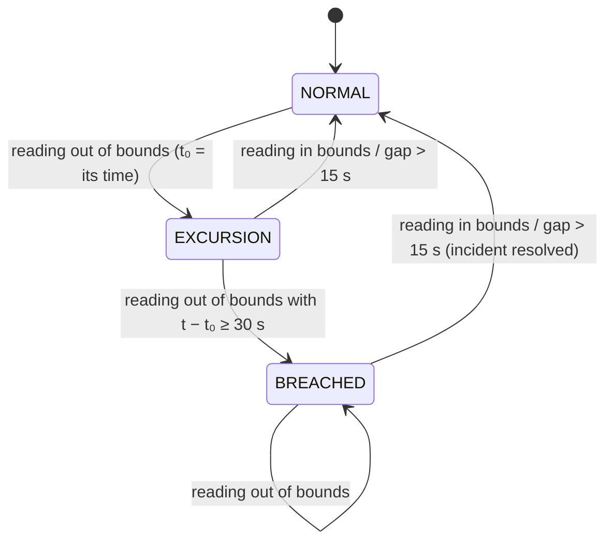
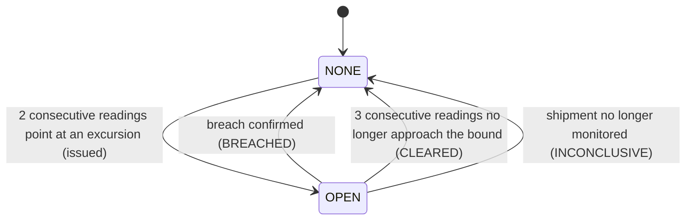

# Cold-Chain Monitoring

## 1. Inputs

- **Readings:** sensors (reefer data loggers) publish readings for the SSCC they are attached to, every
  5 seconds by default. A reading has a device timestamp, temperature (°C), relative humidity (%), and
  position.
- **Bounds:** `[T_min, T_max]`, taken from the shipment's product snapshot at creation time. Later changes
  to the product do not affect shipments that already exist.

## 2. Reading validation

A reading is rejected (counted and logged, but not stored) if any of the following holds:

- The SSCC is not a valid SSCC-18.
- Temperature is outside −50…80 °C, humidity is outside 0…100 %, or the coordinates are out of range.
- The device timestamp is more than 5 minutes in the future or more than 24 hours in the past, relative to
  the time the message was received.

Duplicate readings (same SSCC, device, and timestamp) are stored once.

## 3. Evaluation scope

- Readings are evaluated only for shipments that the telemetry service knows (through its shipment
  projection) and whose status is `CREATED` or `IN_TRANSIT`.
- Readings for unknown or finished shipments are stored but not evaluated.

## 4. Breach rule

The bounds are inclusive. A reading is an **excursion** if `T < T_min` or `T > T_max`.

For each SSCC, the detector runs an episode state machine over readings in device-time order:



- **Continuity:** an episode requires consecutive out-of-bounds readings with no gap larger than
  **15 seconds** (3 × the nominal interval). A gap ends the episode, because missing data is not
  evidence of a sustained excursion. A gap that ends a `BREACHED` episode resolves its incident at the
  last reading received.
- **One incident per episode:** the transition to `BREACHED` creates exactly one incident with
  `started_at = t₀` and `confirmed_at = t`. While the episode continues, the incident tracks the extreme
  temperature. The transition back to `NORMAL` sets `ended_at` and the final duration.
- **Ordering:** a reading whose time is not after the last evaluated reading for that SSCC is stored but
  not evaluated.
- **Multiple devices:** readings from all devices on the same SSCC feed one episode stream. Readings that arrive
  together are evaluated in device-time order.
- **End of monitoring:** when the shipment becomes `DELIVERED`, `CANCELLED`, or `RECALLED`, its readings are no
  longer evaluated, so none can end an open incident. The incident is resolved at the last reading recorded
  until the status change.

## 5. On breach confirmation

Within one second of processing the confirming reading, the system:

1. Inserts the incident, together with its `incident_hash`
   ([ADR-0006](../adr/0006-tamper-evident-event-hashing.md)).
2. Produces `cold_chain.breach_confirmed` to Kafka topic `telemetry.incidents`.
3. Pushes `cold_chain.breach_confirmed` over WebSocket to every participant tenant of the shipment and to
   its assigned driver.

On resolution, `cold_chain.breach_resolved` is produced and pushed the same way.

Incidents and their events take IDs derived from the episode (its SSCC and start), so processing a reading again
never yields a second incident or a different event: a repeated event has the same `event_id`.

## 6. State recovery

- Episode state is held in memory per SSCC by the consumer that owns the SSCC's Kafka partition.
- When a partition is assigned, which happens on startup or rebalance, state for an SSCC is rebuilt lazily
  from its first new reading. The rebuild starts from the SSCC's latest incident (an open one continues the
  episode) and evaluates the SSCC's readings of the last 60 seconds again. A batch that fails also drops the
  state, so its retry rebuilds it the same way.
- Because incidents are unique per `(sscc, started_at)`, a rebuild never duplicates one. It records a
  confirmation or resolution that a failed batch did not persist, and only then produces its event.

## 7. Excursion warnings

An excursion warning forecasts that a shipment's temperature will leave its bounds soon, so that someone can act
before a breach ([ADR-0023](../adr/0023-predictive-excursion-warnings.md)). Warnings are advisory: they never change
the breach rule of §4, and incidents never depend on them.

### 7.1 Forecast

For each monitored SSCC, the detector keeps the in-bounds readings of the last **2 minutes** (all devices, in
device-time order) and fits a straight line `T = a + b·t` to them by ordinary least squares. The forecast at a
reading is:

- the **slope** `b` in °C per minute, and its t-statistic `b / SE(b)`;
- the **fitted temperature** `T̂` at the reading's time;
- the **bound** it approaches: `T_max` when `b > 0`, `T_min` when `b < 0`;
- the **time to excursion** `τ = (bound − T̂) / b`, or 0 when `T̂` is already past the bound, and the predicted
  excursion time, the reading's time plus `τ`.

A forecast needs at least **12 readings spanning at least 60 seconds**. A gap longer than 15 seconds empties the
window: as for episodes, missing data is not evidence of a trend. A reading out of bounds empties it too, so the
trend after an excursion is that of the readings since it ended, not a slope across the excursion.

The **operating level** is the temperature that the reefer has been holding: where the SSCC's last **360 in-bounds
readings** (30 minutes at the nominal interval) cluster most. It is the median of the readings within 0.5 °C of the
center of the densest 0.5 °C bin. The ramps of an excursion pass through many bins quickly and do not move it, and
because it counts readings rather than minutes, after a breach of hours it is still what the reefer held before.
The **current temperature** is the median of the readings of the last minute.

### 7.2 Warning rule

A reading in bounds **points at an excursion** when its forecast:

1. has a slope of at least **0.05 °C per minute** that is significant: `|t| ≥ 3`;
2. reaches the bound within the **horizon of 10 minutes**: `τ ≤ 10 min`;
3. follows a real departure: the current temperature lies at least **0.3 °C** beyond the operating level, on the
   side of the bound (above it when rising, below it when falling).

Rule 3 keeps a load that is recovering toward its level, for example after a door was closed, from raising a
warning about the opposite bound. It compares observed medians, not the fitted line, because a straight line fitted
across the end of a recovery overshoots the level.



- **Issue:** a warning is issued when two consecutive readings point at an excursion and the SSCC has no open
  warning. It records the reading's time (`issued_at`) and temperature, the bound, the slope, and the predicted
  excursion time. An SSCC has at most one open warning.
- **Breached:** when a breach is confirmed while a warning is open, the warning is closed as `BREACHED` at the
  confirmation and linked to the incident. Its **lead time** is the incident's `started_at` minus `issued_at`.
- **Cleared:** when three consecutive readings in bounds have a forecast whose slope no longer moves toward the
  warned bound, or whose time to excursion exceeds 20 minutes, the warning is closed as `CLEARED` at the third.
- **Inconclusive:** when the shipment stops being monitored, an open warning is closed as `INCONCLUSIVE` at the
  last reading recorded until then.
- Readings out of bounds neither issue nor clear a warning, and they restart both counts and the window: the breach
  rule decides what an excursion becomes. A gap restarts them too, and a warning stays open across a gap.

### 7.3 Forecast quality

Every closed warning is a labelled forecast, so the service measures its own forecast quality over a period
(`GET /api/v1/telemetry/warnings/performance`). Warnings count by `issued_at` and incidents by `started_at`.

| Measure | Definition |
| --- | --- |
| Precision | `BREACHED / (BREACHED + CLEARED)` warnings. Open and `INCONCLUSIVE` warnings are not counted. |
| Recall | Incidents that a warning was closed as `BREACHED` with, divided by all incidents |
| Lead time | Median, minimum, and mean lead time of `BREACHED` warnings |
| Excursion time error | Mean of `|started_at − predicted_excursion_at|` over `BREACHED` warnings |

A `CLEARED` warning may be a breach that someone prevented after the warning, so precision measured in operation is
a lower bound. The evaluation run of the demonstration kit, where nobody intervenes, measures it exactly.

### 7.4 Notifications and recovery

- Issuing a warning inserts it, produces `cold_chain.warning_issued` to Kafka topic `telemetry.forecasts`, and
  pushes it over WebSocket to every participant tenant of the shipment and to its assigned driver. Closing it
  updates it and does the same with `cold_chain.warning_closed`.
- Warnings and their events take IDs derived from the SSCC and `issued_at`, and closing is a conditional update
  of the open warning, so processing a reading again never yields a second warning or a different event.
- Forecast state lives in memory next to the episode and is rebuilt with it (§6): the open warning from the
  database, the window from the last 2 minutes of readings, and the operating level from the last 360 in-bounds
  readings before them.
  Readings read back during a rebuild fill the window but do not issue or clear warnings; the counts start again at
  the first new reading. A breach that the rebuild confirms still closes the open warning.

## 8. Thermal exposure and shelf life

The thermal exposure summarizes what the cold chain did to a shipment, and the shelf-life estimate what that costs
the goods ([ADR-0024](../adr/0024-thermal-exposure-and-dynamic-shelf-life.md)).

### 8.1 Exposure

The exposure covers the shipment's readings until **assessment time**: the end of monitoring (the event that took
the shipment out of `CREATED` or `IN_TRANSIT`), or now while it is monitored.

- Readings of all devices are merged in device-time order. Each reading stands for the time until the next
  reading, at most 15 seconds (the gap limit); the last reading stands for no time. Time beyond the limit is
  reported as **uncovered**.
- **Mean temperature:** time-weighted, `Σ Δtᵢ·Tᵢ / Σ Δtᵢ`.
- **Mean kinetic temperature** (USP <1079>), with temperatures in kelvin and `ΔH/R = 83 144 / 8.3144 = 10 000 K`:

  ```text
  MKT = (ΔH/R) / −ln( Σ Δtᵢ·e^(−(ΔH/R)/Tᵢ) / Σ Δtᵢ )
  ```

- **Time above `T_max` and below `T_min`**, and **degree-minutes** above and below:
  `Σ Δtᵢ·max(Tᵢ − T_max, 0)` and `Σ Δtᵢ·max(T_min − Tᵢ, 0)`, in °C·min.

### 8.2 Shelf life

- **Label shelf life:** from the start of the lot's production date to the end of its expiration date. Dates are
  whole days in UTC, and an expiration date means the goods are good until the end of that day.
- **Aging rate:** the label shelf life holds while the goods stay within their bounds. Above `T_max`, the goods
  age faster by `r(T) = Q10^((T − T_max) / 10)`, where Q10 is the product's `shelf_life_q10` (default 3.0) as the
  shipment copied it.
- **Extra aging:** `E = Σ Δtᵢ·(r(Tᵢ) − 1)` over the readings above `T_max`. Time below `T_max` earns no credit, so
  the estimate never extends the label date. Cold damage below `T_min` is covered by breaches, not by this model.
- **Estimated expiry:** the label expiry minus `E`. The **estimated expiration date** is the day of the last moment
  before the estimated expiry.
- **Shelf-life loss:** `E` as a percentage of the label shelf life.
- **Remaining shelf life:** the estimated expiry minus the assessment time.
- **Status:**

  | Status | Condition |
  | --- | --- |
  | `EXPIRED` | Remaining shelf life ≤ 0 |
  | `REDUCED` | Shelf-life loss ≥ 1 % |
  | `INTACT` | Otherwise |

Example: fresh milk bounded at 2–8 °C, Q10 = 3, produced on 1 September and expiring on 14 September (14 days). Three
hours at 22 °C age it by `3^1.4 = 4.66` times, so `E = 3 h × 3.66 = 11.0 h`: a loss of 3.3 %, status `REDUCED`.
The goods are now expected to expire at about 13:00 UTC on 14 September instead of the end of the day
([test vectors](../contracts/test-vectors/thermal-exposure.json)).

### 8.3 Shelf-life alerts

- The detector assesses the shelf life of a shipment when one of its breaches is resolved, and every 15 minutes of
  device time while a breach lasts, as of the reading that triggers the assessment. The projector does the same
  when it resolves a breach at the end of monitoring.
- When the status is worse than the last one notified for the shipment (`INTACT` < `REDUCED` < `EXPIRED`), the
  assessment produces `cold_chain.shelf_life_reduced` to `telemetry.forecasts` and pushes it to the shipment's
  participants and its assigned driver. Each status is notified at most once per shipment.
- Shipments whose projection has no production date (created before shelf-life fields existed) have an exposure
  without the shelf-life part and no shelf-life alerts.
